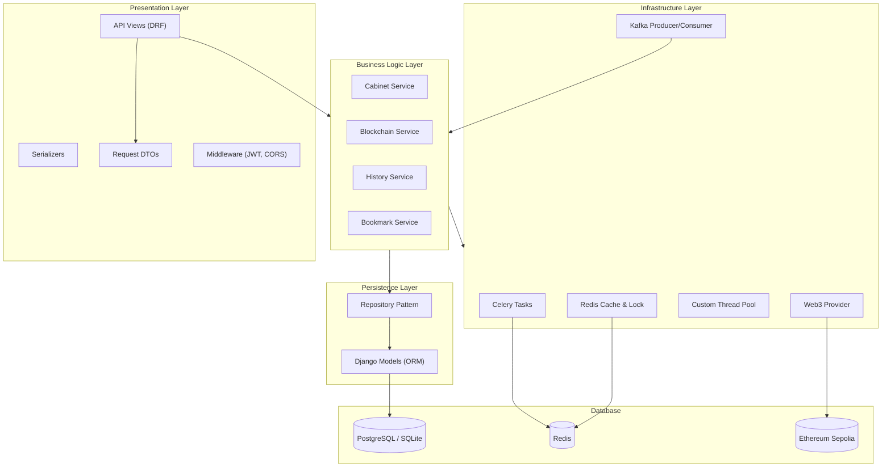
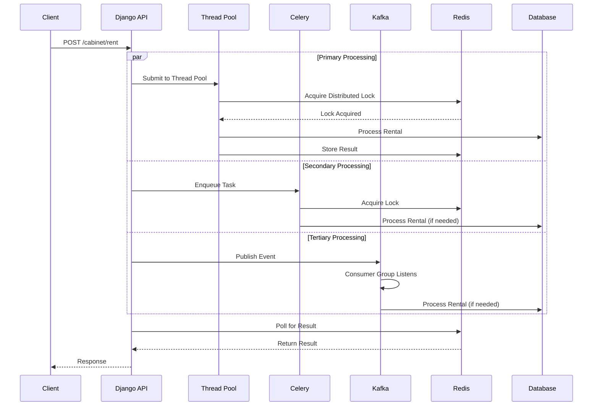
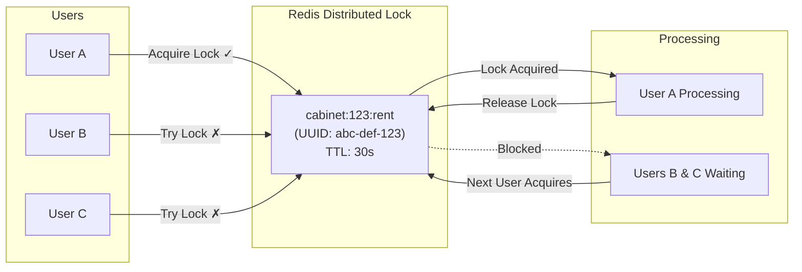
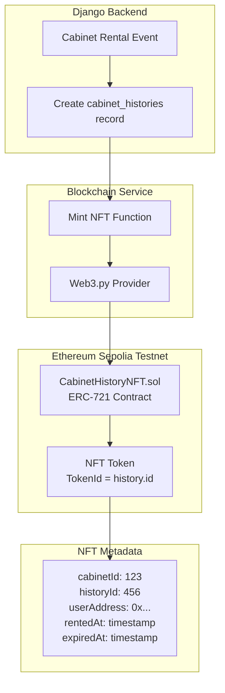
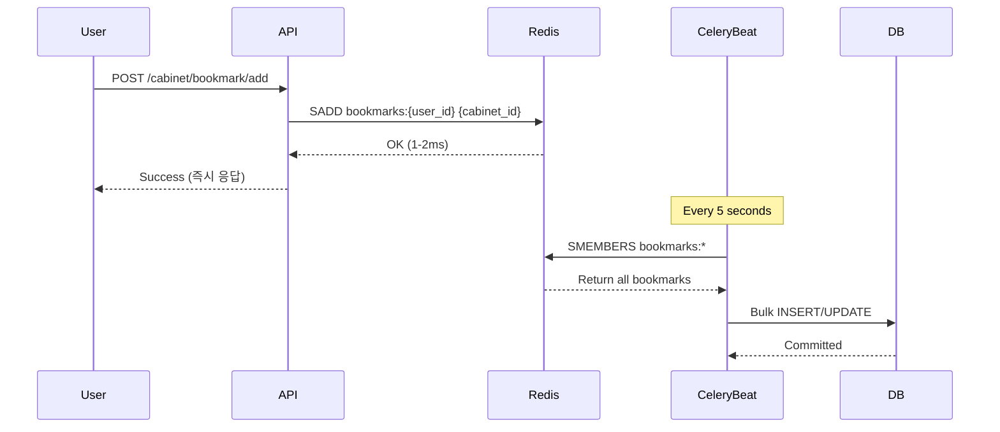
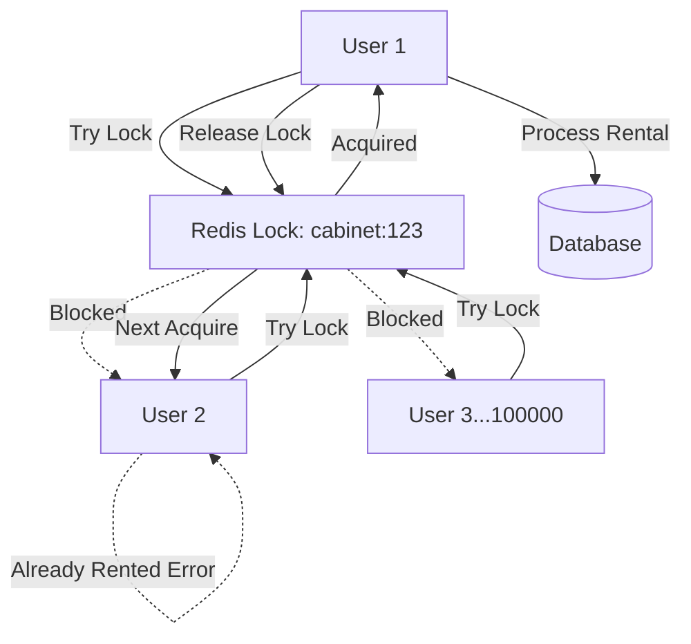
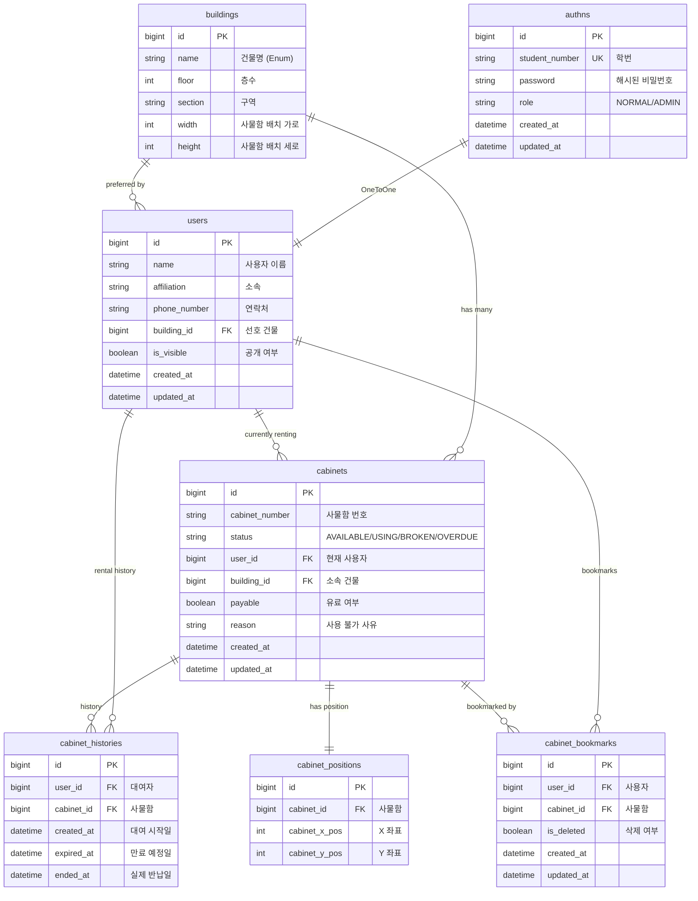

# univCabi - Backend

대학 사물함(캐비닛) 대여 관리 시스템의 백엔드 서버입니다. Django 프레임워크를 기반으로 Clean Architecture 원칙을 적용하고, Celery + Redis + Kafka를 활용한 대규모 트래픽 처리 및 블록체인 기반 이력 관리 기능을 제공합니다.

## Backend Architecture Structure

본 프로젝트의 백엔드는 복잡한 비즈니스 로직을 효율적으로 처리하고, 유지보수성과 확장성을 확보하기 위해 다음과 같은 아키텍처 설계를 적용했습니다.

### Key Architectural Concepts

#### Django-Based Layered Architecture

Django 프레임워크의 강점(ORM, Admin, Middleware)을 유지하면서도 Clean Architecture 원칙을 적용하여 비즈니스 로직을 프레임워크로부터 분리했습니다.

#### Triple-Redundancy Async Processing Architecture

대규모 트래픽 처리를 위해 **3단계 병렬 처리 아키텍처**를 구현했습니다:

**각 계층의 역할:**

1. **Thread Pool (Primary)** - 가장 빠른 응답 속도

   - 애플리케이션 내부 스레드 풀 (5 workers)
   - 즉각적인 처리로 평균 응답시간 최소화
   - 경량 작업에 최적화

2. **Celery (Secondary)** - 안정성과 확장성

   - Redis 기반 분산 작업 큐
   - Thread Pool 과부하 시 자동 처리
   - 재시도 로직 및 작업 스케줄링

3. **Kafka (Tertiary)** - 장애 복구 및 이벤트 스트리밍
   - 메시지 영속성 보장
   - Consumer Group을 통한 수평 확장
   - 시스템 장애 시에도 이벤트 손실 방지

#### Distributed Locking Strategy

Redis를 활용한 분산 락으로 동시성 문제를 해결했습니다:

**구현 특징:**

- UUID 기반 소유권 검증
- 자동 TTL로 데드락 방지
- 사물함별 독립적인 락 (세밀한 동시성 제어)

#### Blockchain-Based Audit Trail

블록체인(Ethereum)을 활용한 변조 불가능한 대여 이력 관리:

**활용 사례:**

- 학생의 사물함 사용 이력을 블록체인에 영구 기록
- 대여/반납 시점의 변조 방지
- 투명한 관리 기록 및 감사 추적
- NFT 기반 디지털 증명서 발급

## Traffic Handling Strategy

### 고성능 처리 기법

#### Redis 기반 즐겨찾기 버퍼링

#### 동시성 제어를 통한 데이터 정합성

**시나리오**: 100000명의 사용자가 동시에 같은 사물함 대여 시도

---

## Database Schema

### ERD (Entity Relationship Diagram)

---

## Technology Stack

### Backend Framework

- **Django**: 5.2.1
- **Django REST Framework**: 3.15.2
- **Python**: 3.10+

### Authentication

- **djangorestframework-simplejwt**: 5.4.0

### Database

- **Development**: SQLite3
- **Production**: PostgreSQL (지원)
- **ORM**: Django ORM

### Caching & Message Queue

- **Redis**: 5.2.1
- **django-redis**: 5.4.0
- **Celery**: 5.5.2
- **kafka-python**: 2.1.5

### Blockchain

- **Web3.py**: 7.11.0
- **Solidity**: ^0.8.0
- **Network**: Ethereum Sepolia Testnet
- **Provider**: Infura

### API Documentation

- **drf-yasg**: 1.21.8 (Swagger/OpenAPI)

### Development Tools

- **django-environ**: 0.11.2 (환경 변수 관리)
- **django-cors-headers**: 4.6.0 (CORS)

---

## 🧑🏻‍💻 프로젝트 멤버

|  이름  | 역할                          | GitHub                                      |
| :----: | :---------------------------- | :------------------------------------------ |
| 민영재 | PM, Backend, Frontend, Design | [yeomin4242](https://github.com/yeomin4242) |
| 민웅기 | Backend, Frontend, Design     | [minwoonggi](https://github.com/minwoonggi) |
| 김주희 | Frontend, Design              | [joooii](https://github.com/joooii)         |
